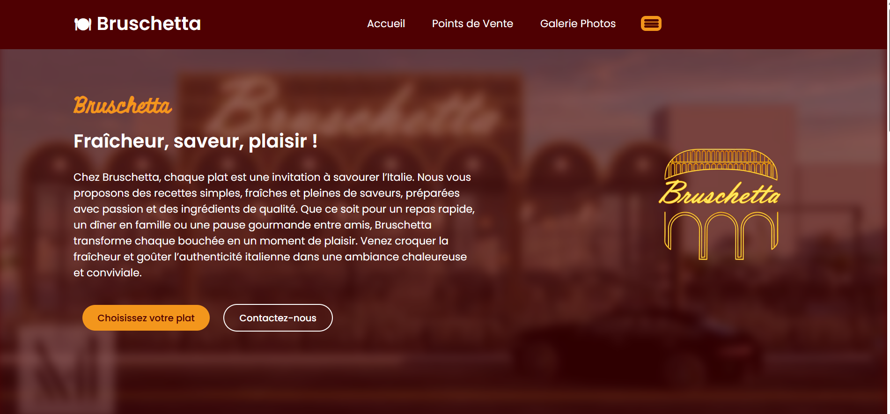
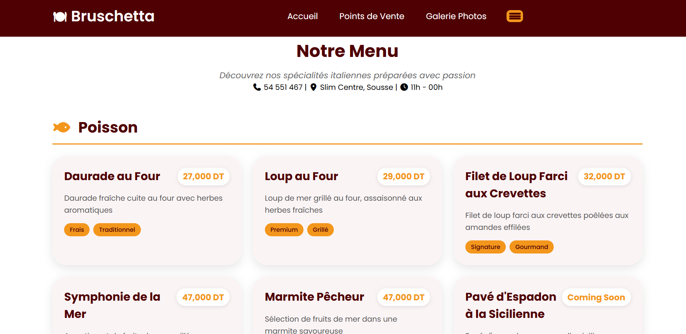
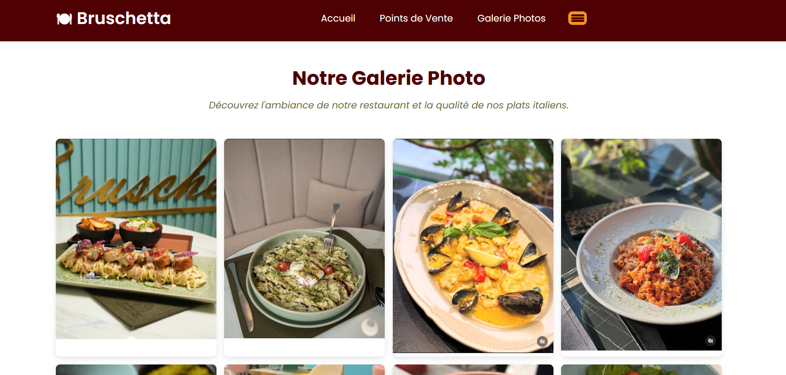
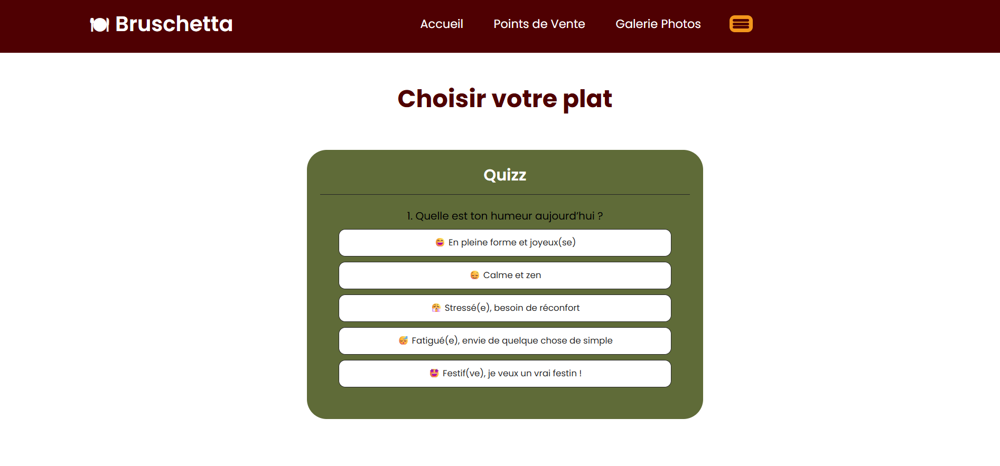
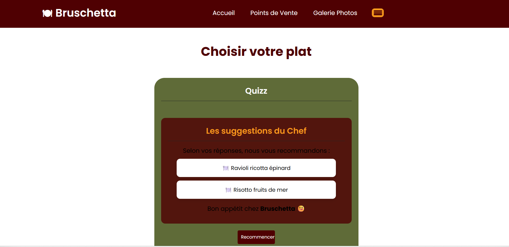

#  Bruschetta | Interactive Restaurant Website

<p align="center">
  <strong>A digital experience designed to bring the restaurant closer to its customers.</strong>
</p>

<p align="center">
  A modern and interactive restaurant website combining an engaging visual experience, accessible restaurant information, a digital food menu, and personalized meal discovery.
</p>

---

##  About the Project

**Bruschetta** is a restaurant website developed to establish a digital presence for the restaurant while providing visitors with an intuitive and engaging way to explore its identity, discover its dishes, and find meals that match their personal preferences.

The platform goes beyond a traditional restaurant presentation website by introducing an interactive food recommendation quiz. Through a series of questions about their mood, tastes, and meal preferences, visitors can discover food suggestions that better match what they are looking for.

The main idea is simple: **help customers find the right meal for the right moment.**

##  Features

###  1. Restaurant Presentation
- Introduction to the Bruschetta restaurant.
- Presentation of the restaurant's identity and concept.
- Dedicated section providing information about the restaurant.
- Access to relevant location and visit information.

###  2. Digital Menu
- Dedicated menu section presenting the restaurant's food selection.
- Visual presentation of available dishes.
- Clear and accessible browsing experience to help visitors explore the menu.

###  3. Food Gallery
- Dedicated photo gallery showcasing selected restaurant dishes.
- Visual exploration of the food and restaurant offering.
- Engaging presentation that helps visitors discover the restaurant's culinary identity.

###  4. Interactive Food Recommendation Quiz

One of the project's distinctive features is an interactive quiz designed to make meal discovery more personal and enjoyable.

Instead of browsing the entire menu without guidance, visitors can answer questions related to:
- Their current mood.
- Their food preferences.
- Their cravings and meal preferences.
- What they feel like eating at that moment.

Based on their answers, the quiz guides visitors toward suitable menu recommendations.

**The objective:** transform menu exploration into a more interactive and personalized experience.

###  5. User Experience
- Intuitive navigation between website sections.
- Visually engaging restaurant and food presentation.
- Interactive elements designed to encourage visitor engagement.
- Consistent digital experience across the different sections.

##  User Journey

The website provides visitors with a straightforward journey:

1. **Discover:** Explore the Bruschetta restaurant and learn about its concept.
2. **Explore:** Browse the food gallery and discover the menu.
3. **Interact:** Take the food recommendation quiz.
4. **Personalize:** Answer questions about mood and food preferences.
5. **Discover a Match:** Receive meal suggestions based on the quiz responses.

##  Technologies & Tools

The project uses web development technologies to build its interface and interactive features.


- **Frontend:** HTML, CSS, JavaScript 
- **Styling:** CSS,Tailwind CSS 
- **Interactive Features:** JavaScript
- **Development Tools:** VS Code

##  Project Structure

The project is organized around its main website components and resources.

```text
bruschetta-restaurant-website/
│
├── index.html
├── galerie.html
├── menu.html
├── plat.html
├── points-de-vente.html
├── bruschetta.css
├── bruschetta.js
│   
├── images
├── readme.md
└── 
```


##  Getting Started

Follow these steps to run the project locally.

### Prerequisites

- Git
- A modern web browser

### Installation

**1. Clone the repository**

```bash
git clone https://github.com/elaaabenothmen2/bruschetta-restaurant-website.git
```

**2. Navigate to the project directory**

```bash
cd bruschetta-restaurant-website
```

**3. Run the project**

Open `index.html` in your browser or use a local development server.


## 📷 Screenshots & Preview
*** Demo: ***

Bruschetta Homepage:

Restaurant Menu:
 
Food Gallery:

Food Quiz:

Meal Recommendation:

##  Potential Future Improvements

Possible extensions to further enhance the platform include:

- Online table reservation functionality.
- Online ordering and takeaway services.
- More advanced personalized food recommendations (ai model).
- Customer reviews and ratings.

##  Project Purpose

This project explores how a restaurant's digital presence can combine information, visual storytelling, and interactive functionality to create a more engaging customer experience.

It also provides practical experience in designing and developing a user-oriented web application, with a focus on interface organization, interactive features, and personalized user journeys.

##  Author

**Elaa Ben Othmen**

- GitHub: [Your GitHub Profile](https://github.com/elaaabenothmen2)
- LinkedIn: [Your LinkedIn Profile](https://www.linkedin.com/in/elaa-ben-othmen-7b993a2a4/)

---

<p align="center">
  <strong>Bruschetta — Discover the restaurant. Explore the menu. Find your perfect meal.</strong>
</p>